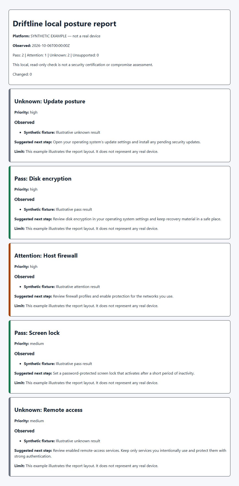

# Driftline

Private security posture checks for your own computer. See what changed since your last check and the next useful action.

A free CLI for students, home users, developers, and small IT teams. It reads five narrow signals: updates, disk encryption, firewall, screen lock, and remote access. Every result has evidence or a limitation.

**Local preview:** Windows has received a live check. macOS/Linux have fixture tests; native validation remains pending. Daily adoption is a hypothesis.

## Quick start

Install [Node.js 22 or newer](https://nodejs.org/en/download), then open a terminal in this extracted project folder:

```sh
node bin/driftline.js check --no-history
```

No package installation is needed. Existing Node users should reach their first result in under two minutes.

```sh
node bin/driftline.js check
node bin/driftline.js status
node bin/driftline.js check --json
node bin/driftline.js report --format html --output report.html
node bin/driftline.js report --format markdown --output report.md
node bin/driftline.js acknowledge remote-access
```

Reports refuse to overwrite files. Acknowledgement records your review; it never changes or hides a result.



This example uses labeled synthetic test data, not a real device.

## Results

| Result | Meaning |
| --- | --- |
| Pass | The specific, limited signal matched. Read its scope. |
| Attention | A verified signal needs review; it may be intentional. |
| Unknown | Available evidence cannot establish the result. |
| Unsupported | No probe runs for that platform. |

No security score. Five results do not establish security, patch freshness, compliance, or absence of malware. Update services and local package metadata never establish a false all-clear. Verify updates in native settings.

## Privacy and storage

No telemetry, account, network API, listener, background task, or automatic remediation. Probes run fixed read-only commands with time and output bounds. macOS reads its update schedule; Linux uses existing package metadata.

History retains one snapshot, latest changes, and acknowledgement timestamps. Probes emit fixed summaries instead of raw output, identifiers, or package inventories. Pattern redaction adds a secondary safeguard.

- Windows: current user's AppData/Roaming/Driftline.
- macOS: current user's Library/Application Support/Driftline.
- Linux: XDG_STATE_HOME/driftline, or current user's .local/state/driftline.

Use **--no-history** for no state reads/writes. Use **--data-dir PATH** to choose a directory you control. Run one process per data directory; state has no multi-process lock. Review posture reports before sharing.

## Arabic

```sh
node bin/driftline.js report --format html --output report-ar.html --lang ar
```

Arabic headings/control titles are experimental. HTML uses RTL layout and bidirectional isolation. Evidence and guidance remain English. Translation files: src/i18n.js and data/packs/core.json.

## Optional local installation

Windows: run scripts/install.ps1. macOS/Linux: run **sh scripts/install.sh**. These scripts register the CLI from this checkout; keep the checkout in place. They print exact run/uninstall commands. Direct Node commands always work.

## Development

Use the source checkout/source ZIP for development; the npm archive omits tests, CI and the lockfile.

```sh
npm ci --ignore-scripts --offline --no-audit --no-fund
npm run check
npm run security-check
npm test
npm audit --audit-level=high
npm pack --dry-run
```

No runtime packages. Node's built-in runner provides tests. The check command validates syntax, whitespace, imports, and cycles. The security guard covers limited forbidden APIs and secret formats, not a complete audit. CodeQL and cross-platform CI are prepared but have not run remotely. No static type checker is used for this JavaScript preview; schema validation and contract tests check data boundaries.

```sh
docker build -t driftline-dev .
docker run --rm driftline-dev
```

Docker is a development/test option and prints help. It cannot assess the host. Do not add host mounts or privileges. Verify the version-pinned image digest/build before release.

## Evidence and contribution

- [Research](docs/RESEARCH.md) and [perspective workbook](docs/STORM_WORKBOOK.md)
- [Architecture](docs/ARCHITECTURE.md), [validation and limits](docs/VALIDATION.md)
- [Supply-chain inventory](docs/SUPPLY_CHAIN.md)
- [Contributing](CONTRIBUTING.md), [roadmap](ROADMAP.md), [security reporting](SECURITY.md)

Driftline complements native settings and deeper tools such as Lynis, Wazuh, and Greenbone. Its coverage is much narrower.

Apache-2.0. See LICENSE and NOTICE.
