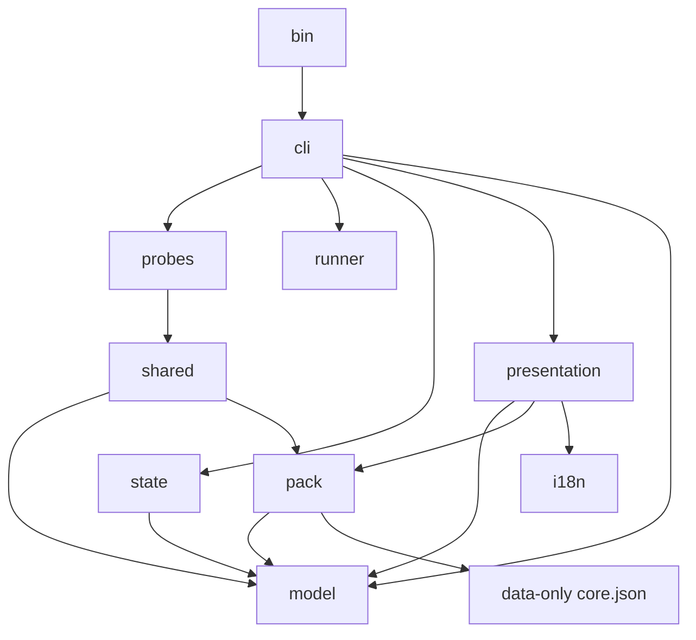

# Dependency graph substitute

Graphify returned no_workspace. No competing or local Graphify graph was produced. This diagram comes from local imports. npm run check verifies import resolution and rejects cycles.

App modules use Node standard-library modules only. Runner is the sole app module importing child_process. The limited static guard found no network imports. This is not a complete behavioral or dead-code proof.
